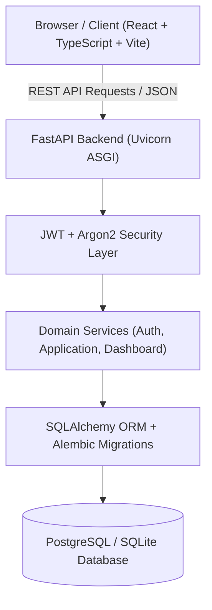

# Kiến trúc hệ thống CareerFlow

## Tổng quan kiến trúc

CareerFlow được thiết kế theo kiến trúc **Decoupled Client-Server (Full-stack)**:

## Các nguyên tắc thiết kế quan trọng

1. **User Isolation (Multi-tenancy at Query Level)**:
   - Backend không bao giờ tin tưởng `user_id` truyền từ client payload.
   - Toàn bộ thao tác CRUD và thống kê đều trích xuất `current_user.id` trực tiếp từ JWT Bearer token đã xác thực chữ ký HMAC-SHA256.

2. **State Machine & Audit Logging**:
   - Mọi thay đổi trạng thái của đơn ứng tuyển (`SAVED` -> `APPLIED` -> `INTERVIEW` -> `OFFER` / `REJECTED`) đều tự động sinh ra một bản ghi trong `application_status_history` để phục vụ tính toán tỷ lệ chuyển đổi (`Conversion Rate`) chính xác.

3. **Database Portability**:
   - Phát triển local: Sử dụng SQLite (`sqlite:///./careerflow.db`) để khởi động tức thì không cần cài thêm service.
   - Production / Docker: Chuyển đổi linh hoạt sang PostgreSQL (`postgresql://...`) chỉ bằng cách thay đổi biến môi trường `DATABASE_URL`.
