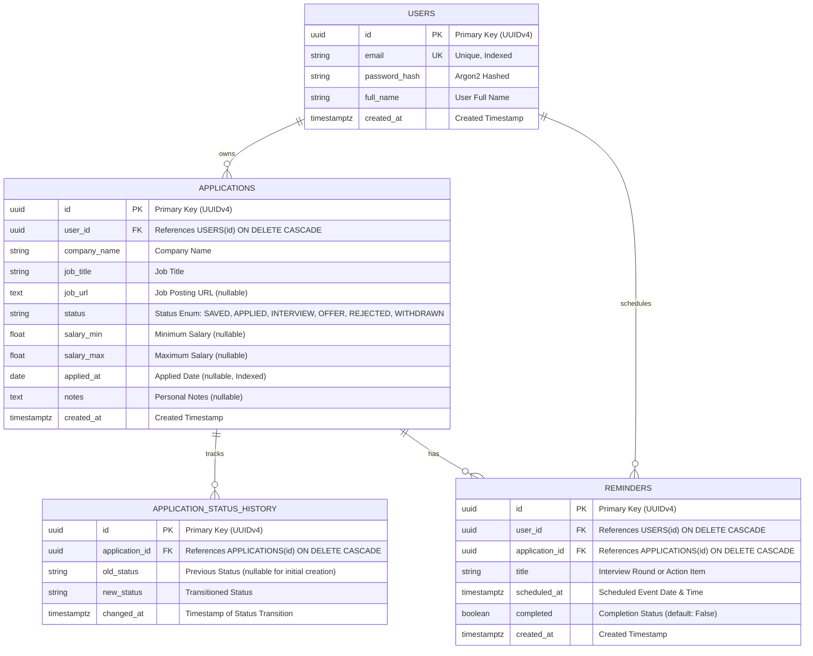

# CareerFlow — Database Entity Relationship Diagram (ERD)

## Sơ đồ quan hệ thực thể

## Các ràng buộc và tối ưu hóa

1. **Khóa ngoại & Xóa theo tầng (`ON DELETE CASCADE`)**:
   - Khi xóa một User, toàn bộ `applications` và `reminders` của người dùng đó sẽ tự động được thu hồi.
   - Khi xóa một Application, toàn bộ `application_status_history` và `reminders` gắn với đơn đó sẽ tự động xóa sạch để tránh rác dữ liệu (orphan records).

2. **Chỉ mục (Indexes)**:
   - `users.email`: Đảm bảo tra cứu đăng nhập nhanh O(1) và tính duy nhất.
   - `applications.user_id`: Đảm bảo lọc dữ liệu cô lập theo người dùng (`Multi-tenancy isolation`) với hiệu năng cao.
   - `applications.status`: Tối ưu hóa truy vấn Kanban và thống kê Dashboard.
   - `applications.applied_at`: Tối ưu hóa lọc theo khoảng thời gian.
